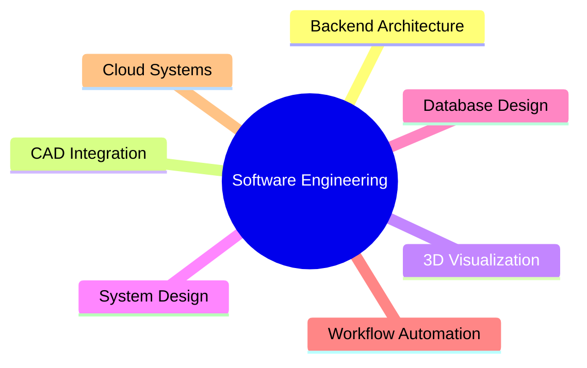

# Hey there 👋 I'm Mehul Gidwani

### Software Developer | CAD Integration | 3D Visualization

Building enterprise software, scalable backend systems, engineering workflows, and interactive 3D experiences.

---

## 🚀 About Me

I'm a software developer with **3+ years of experience** building enterprise-grade solutions across web, backend, CAD, and visualization domains.

My work revolves around creating systems that are:

- ⚡ Scalable under growing business demands
- 🔗 Seamlessly integrated with third-party platforms
- 🏗️ Designed with maintainable architecture
- 📊 Optimized for high-performance data processing
- 🎨 Enhanced with modern 3D visualization experiences

I've worked on everything from enterprise web applications and workflow automation to CAD integrations and backend platforms that support mission-critical business operations.

---

## 🎯 Areas of Focus

---

## 🧠 Currently Exploring

- Cloud-Native Applications
- Large Scale Data Processing
- Software Architecture Patterns

---

## 🌍 Let's Connect

I'm always interested in discussions around:

- Enterprise Software Architecture
- CAD & Engineering Platforms
- System Design

---

### "Good software scales. Great software stays maintainable while scaling."

