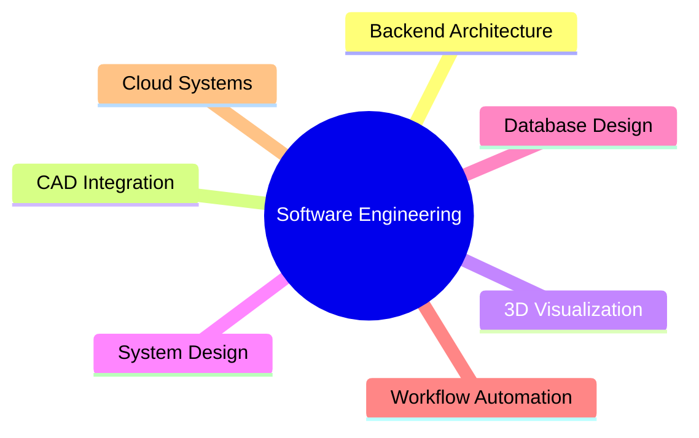

<div align="center">

# Hey there 👋 I'm Mehul Gidwani

### Software Developer | Enterprise Applications | CAD Integration | 3D Visualization

<p>
Building enterprise software, scalable backend systems, engineering workflows, and interactive 3D experiences.
</p>

</div>

---

## 🚀 About Me

I'm a software developer with **3+ years of experience** building enterprise-grade solutions across web, backend, CAD, and visualization domains.

My work revolves around creating systems that are:

- ⚡ Scalable under growing business demands
- 🔗 Seamlessly integrated with third-party platforms
- 🏗️ Designed with maintainable architecture
- 📊 Optimized for high-performance data processing
- 🎨 Enhanced with modern 3D visualization experiences

I've worked on everything from enterprise web applications and workflow automation to CAD integrations and backend platforms that support mission-critical business operations.

---

## 💡 What I Enjoy Building

### Enterprise Applications
- Business process automation
- Workflow management platforms
- Internal enterprise tools
- Data-driven business applications

### 3D Visualization
- Web-based 3D experiences
- Interactive visualization tools
- Real-time rendering workflows
- Engineering and product visualization

---

## 🛠️ Tech Stack

### Languages

```text
JavaScript • TypeScript • C# • SQL
```

### Frontend

```text
React • Angular • Next.js • HTML • CSS
```

### Backend

```text
.NET • Node.js • REST APIs • Microservices
```

### Data & Storage

```text
SQL Server • PostgreSQL • MySQL
```

### Cloud & DevOps

```text
Azure • Docker • CI/CD
```

### Specialized Domains

```text
CAD Integration
3D Visualization
Enterprise Architecture
Workflow Automation
System Integration
Performance Optimization
```

---

## 🎯 Areas of Focus



---

## 📈 Engineering Principles

- Build for scale from day one
- Keep systems maintainable and observable
- Optimize only after measuring
- Automate repetitive workflows
- Design APIs consumers enjoy using
- Model data carefully before writing code

---

## 🧠 Currently Exploring

- Cloud-Native Applications
- Large Scale Data Processing
- Software Architecture Patterns

---

## 🌍 Let's Connect

I'm always interested in discussions around:

- Enterprise Software Architecture
- CAD & Engineering Platforms
- System Design

---

<div align="center">

### "Good software scales. Great software stays maintainable while scaling."

</div>
